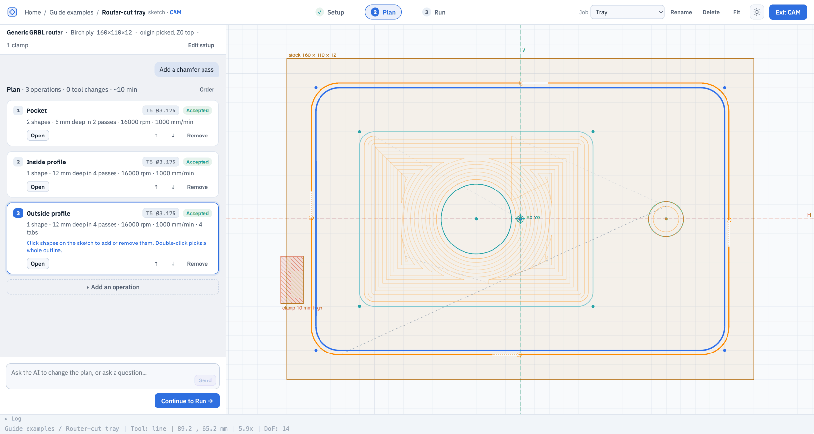
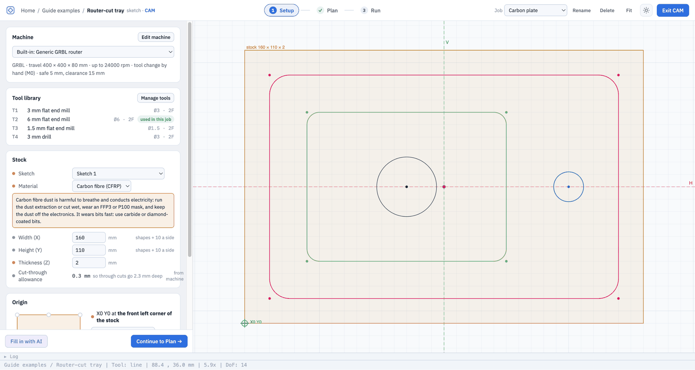
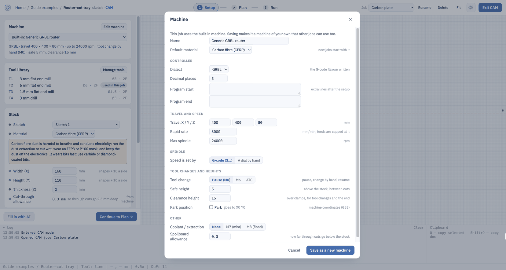
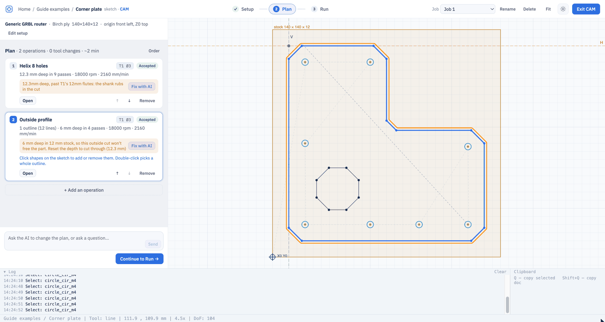

# IntentCAD

**Parametric CAD for 3D printing, driven by AI, with exact geometry you can still
point at, measure and tweak.**

IntentCAD is a web-based CAD tool for designing functional parts: enclosures,
brackets, mounts, knobs, adapters. You describe what you want, the AI builds it as an
exact, parametric model, and you refine it with the same tools you'd find in Fusion or
Onshape (sketches, extrudes, fillets, holes, patterns) whenever pointing is easier
than describing. It's open source (MIT).

---

## The ideas behind it

### Describe the intent; the AI does the modelling

Most CAD time goes into translating an idea into a sequence of tool operations.
In IntentCAD you start from the idea: *"a case for this board, M3 heat-set inserts,
2 mm walls, open top"*. The AI builds it, and you keep talking to it to change it:
*"move the USB cutout 2 mm up"*, *"fillet these edges"*, *"make the lid snap on"*.
Select something in the 3D view first and the AI knows exactly which face or edge you
mean.

### The model is readable, exact and yours

Behind every part is a short, readable script (Python, using the build123d CAD
library) with its key dimensions collected in one place, the **parameters**. That
gives you things a chat-generated mesh never could:

- **Exact geometry.** True solids with real faces and edges, exported as STEP for
  other CAD tools or as STL for printing.
- **Parametric.** Change `wall` from 2 to 3 and everything that depends on it
  follows: sketches, holes, fillets, mirrored and patterned copies.
- **Reproducible.** The same script always builds the same part. Every successful
  build is saved as a version you can go back to.
- **Inspectable.** Nothing is hidden: you, the AI and the buttons all edit the same
  script.

### Point when pointing is easier

Some things are easier to show than to say: *this* edge, *that* face, a hole 14 mm from
*this* wall. For those, IntentCAD has button operations with live previews. Each one
writes a single, readable line into the script, with its values as parameters, and
can be reopened later to change it. The AI can edit what a button made, and a button
can reopen what the AI made.

### Built for 3D printing

IntentCAD knows parts are going to a printer: heat-set insert and screw-hole presets,
standoffs, an overhang check against the print bed, a section view to check walls and
insert depths, shells for enclosures, and automatic softening of edges that keeps
mounting and bed faces sharp.

### Honest numbers

When the AI takes dimensions from a datasheet or a photo, every number says where it
came from: stated in the document, estimated from a drawing's scale, measured from a
photo, or given by you. Estimates are never presented as exact, so you know what to
check before printing.

---

## A quick tour: a case for a circuit board

1. **Give it context.** Add the board's datasheet (a PDF with a dimension drawing) or a
   photo of the board to the project.

   

2. **Ask for the case.** *"Make a 3D-printable case for this board. M3 heat-set inserts
   for the mounting holes, 2 mm walls, open top."* The AI reads the drawing, puts the
   board size and hole pattern into the parameters with their source, and builds the
   case.

   

3. **Refine by pointing.** Select the side wall, sketch the USB opening on it, cut it.
   Drag a parameter's arrow on the model to change it directly.

   

4. **Check it's printable.** Cut the part open with the section view to see wall
   thickness and insert depth; switch on the overhang check.

   

5. **Change your mind.** Make the case 10 mm taller, the walls thicker, the board
   bigger: everything follows.

---

## What you can do

### Design with AI

- Chat to create and change parts; the AI writes and edits the model script.
- Select faces and edges first to say precisely what you mean.
- The AI asks a question when something is ambiguous instead of guessing.
- **Process notes**: tell it how the part will be made (printer, material, clearances)
  and every edit respects it.
- **Fix with AI**: when a build fails (a fillet too big, say), one click asks the AI to
  repair it, keeping your intent.

### Sketch

A full 2D sketcher, usable on its own (for laser and CNC work) and directly on the
faces of a part:

- Lines, polylines with arcs, rectangles (with rounded corners), circles, polygons,
  points, Bézier curves.
- Constraints: coincident, horizontal/vertical (lines or two points), parallel,
  perpendicular, tangent, equal, midpoint, symmetric, point on curve, fixed.
- Dimensions that can be formulas using the part's parameters, e.g. `floor + 2`.
- Corner fillet, trim, offset (stays linked to its source), mirror, grid and circular
  copies.
- Built-in horizontal and vertical axes in every sketch, ready to mirror about.

### Sketch on the part

- Select a flat face or a construction plane and press K: the full sketcher opens on it.
  With nothing selected, K offers the Top, Front and Right planes. Done or Esc takes
  you back to the part, with the sketch drawn on it.
- The face's outline comes into the sketch as reference geometry; click other edges of
  the part to bring them in too, and dimension to them.
- Sketches **follow the part**: if the face moves or its edges change, the sketch moves
  with it.

### Build the part

- **Extrude**: add, cut or start a new body; to a depth, both ways, through everything,
  up to a face, or up to the next face.
- **Revolve**: knobs, spacers, pulleys, grooves; full or partial turns.
- **Hole**: clearance, tapped, heat-set insert, counterbore and countersink, in M2 to M5,
  at sketch points; optionally on a **standoff** with a strengthening fillet at its foot.
- **Shell**: hollow a solid into walls, leaving the faces you choose open.

### Modify

- **Fillet** and **chamfer** the edges you pick (click, Shift-click, or double-click for
  a whole loop).
- **Round**: soften every edge of the part automatically, keeping protected faces
  (mounting faces, the print bed) exactly flat and sharp.
- **Lighten**: cut windows into a flat plate, leaving a rim and ribs around the
  mounting points.

### Symmetry and repetition

- **Mirror** a whole body (model half, mirror to complete it), or mirror chosen steps
  as linked copies that follow their original.
- **Pattern** in a line, a grid or a circle (vents, ribs, bolt circles), leaving out
  any copy you click.

### Reference geometry

- **Construction planes**: offset from a face or base plane (a midplane is just an
  offset of half the width), on an edge at an angle, or tangent to a cylinder for
  radial holes. They follow the part like everything else.

### Parameters and direct manipulation

- All key dimensions live in one parameters list. Type a value, or **drag the arrow**
  on the model and watch the part follow.
- Hold Alt (⌥) to see every parameter drawn as a dimension on the geometry it controls.
- Every operation is a step you can **reopen**, **switch off** or **delete** from the
  steps list.

### Inspect for printing

- **Section view**: cut the part open with a draggable plane; read wall thickness and
  distances straight off the cut.
- **Overhangs**: faces that would print as overhangs or ceilings are shaded, relative to
  the print bed you choose; one click asks the AI for printable fixes.
- **Measure**: distances, diameters and angles between faces and edges.

### Context files

- Attach datasheets (PDF) and photos to a part or a whole project.
- The AI reads them when designing, and cites the page or photo each dimension came
  from.
- To add one while you chat, click the paperclip left of the message box, or drop or
  paste a file into the chat. On a phone, the paperclip offers the camera.
- The files go with your next message; they show as chips above the box, and the sent
  message lists them after 📎. Click × on a chip to leave a file out.
- If you send while a file is still uploading, the message waits for it.
- When the AI asks you a question, an **Attach a file** button shows under it: answer
  with a photo, a drawing or a datasheet if that's easier than typing. Pick the file,
  add a sentence and send.
- The **Context** tab lists all the files, and lets you choose which PDF pages the AI
  sees.

### Import and export

- Import STEP files and keep designing on top of them.
- Export STEP (for other CAD tools), STL (per body, too), and DXF outlines (top, front
  and side).

### Projects, versions and sharing

- Organise parts and sketches in projects; share projects with others.
- Every successful build is a version; restore any of them.

### Beyond 3D: 2D and CNC

The 2D editor exports DXF, PDF and images, imports DXF, and turns sketches into G-code
for a CNC router.

Click **CAM** in a sketch's toolbar. CAM has three steps along the top: **Setup**,
**Plan** and **Run**. **Job** picks a job or adds one; jobs save by themselves. **Exit
CAM** (or Esc) goes back to drawing. **Fit** (Shift+F) frames the stock.

**1 Setup** says what you cut on, once per job:

- **Machine**: the router. **Edit machine** sets its controller, travel, top speed, how
  the spindle speed is set (by the program, or by hand on a dial with a table of
  settings), rapid speed, tool changes (a pause, M6 or an automatic changer), safe and
  clearance heights, where it parks, coolant, and the **spoilboard allowance**: how far
  a through cut goes past the stock (0.3 mm unless you change it). **Default material**
  is the material new jobs start with (birch ply until you change it): set it once and
  click **Save**. A new job starts on the machine you saved last, so it takes that
  material too. Jobs you already have keep theirs.
- **Tool library**: the machine's bits. **Manage tools** adds and edits them. Each bit
  has cutting data per material: chip load, depth per pass, stepover, plunge speed and
  ramp angle. Birch ply, MDF, hardwood, acrylic, aluminium 6061 and carbon fibre come
  filled in, and you can change them. The feed is always worked out (chip load × flutes
  × rpm), never typed.
- **Stock**: width, height, thickness and material. Leave width and height empty to fit
  the shapes plus 10 mm a side.
- **Carbon fibre**: pick *Carbon fibre (CFRP)* as the material. Its cutting data uses a
  small chip, shallow passes (a quarter of the bit: 0.8 mm for a 3 mm bit, 1.5 mm for a
  6 mm one) and a ramp in, to keep the edges from splintering. Setup shows a reminder:
  the dust is harmful and conducts electricity, so run the dust extraction or cut wet
  and wear a mask, and use carbide or diamond-coated bits. Run's steps at the machine
  start with the same reminder. To start every new job in carbon fibre, set it as the
  machine's **Default material**.
- **Origin**: where X0 Y0 is: a corner, an edge's middle or the centre of the stock, or
  **Pick a point on the sketch** (it snaps to shape ends and centres). **Z0 at** is the
  stock top or the spoilboard.
- **Clamps**: click **Draw on the sketch**, drag a box where the clamp is, and set how
  tall it stands. A rapid move that would pass a clamp rises to the clearance height to
  cross it. A cut into a clamp is an error.
- **Fill in with AI** fills these in from the drawing. Whatever the AI set has a violet
  dot. Its changes wait for you: **Confirm** keeps them, **Undo** puts back what was
  there. Nothing downloads until you've chosen.

**2 Plan** lists the operations, in the order they run, with the number of tool changes
and the time:

- **Plan with AI** proposes the operations, each with its reason. Proposed ones have a
  violet **Proposed** label: click **Accept**, or **Accept all**.
- **+ Add an operation** adds one yourself. Click shapes on the sketch to add them to the
  selected operation or take them out; double-click picks a whole outline.
- Lines that meet end to end are one outline. Double-click any of them to pick them all;
  the card then says, for example, "1 outline (12 lines)". A line that doesn't close an
  outline is an error, unless you cut on the line.
- Selecting an operation shows its shapes in blue and its toolpath in orange, with tabs
  marked. The stock, the clamps (hatched red) and X0 Y0 show on the sketch.
- The defaults come from the setup: an outside profile cuts right through (the stock
  thickness plus the allowance) with tabs, holes use a drill bit (or a helix with an end
  mill), pockets use the largest bit that fits, bits long enough for the depth and bits
  already in use come first. A drill bit also goes its point's length further, so the
  hole is full size at the bottom.
  **Order** puts inside cuts first, then groups by tool, with the cut that frees the part
  last.
- A problem shows on its operation; **Fix with AI** asks the AI to fix it. It can change
  the settings or the shapes the operation cuts; **Reject** puts them back.
- An outside profile shallower than the stock won't free the part, so it warns; **Reset**
  the depth in **Open** to cut right through.
- The box at the bottom talks to the AI: "add a chamfer pass", "use the 6 mm bit for the
  pockets", "why two passes?". Its changes come back as proposed. If it changes an
  operation you had accepted, **Reject** puts it back as it was. It can remove only its
  own proposals; it asks you to remove the rest. It names shapes by their size and
  place ("the Ø4 circle at (10, 10)") and operations by their number.

**Open** an operation to change it. Its settings are grouped as What, Tool, Depth,
Speeds and feeds, and How it cuts. A dot beside each value says where it comes from:
grey is inherited from the setup and tool, amber is set here (with what it was, and
**Reset**), violet was set by the AI. A diagram shows the passes. **Ask AI about this
operation** asks about just this one; **Done** goes back to the plan.

- **Profile** cuts along a shape, inside, outside or on the line. A shape inside
  another is a hole and is cut on its inside, before the outline. **Direction** picks
  climb or conventional.
- **Tabs** keep the part joined to the stock; set their number, width and height.
- **Pocket** clears inside a closed shape and leaves islands standing.
- **Drill** drills holes, pecking if you set a peck depth.

**3 Run** checks the job before you cut: errors (such as a proposed operation not yet
accepted, AI setup changes not confirmed, a cut into a clamp, deeper than the bit
reaches, or further below the stock than the spoilboard allowance) block the download
and hide the G-code, and warnings say what to check.
**Play** runs the simulator; the line running is highlighted in the G-code. **At the
machine** lists what to do there: the bit to fit, where to zero, and each tool change
and dial setting. **Download .nc** saves the G-code.

The AI never changes the machine's settings, its post-processor or its safe heights.
What it changes in the job waits for you to accept or confirm it, and goes through the
same checks as your own operations.

---

## What IntentCAD deliberately doesn't do

To stay simple and focused on printed parts, IntentCAD leaves out assemblies with
moving joints between separate documents, 2D technical drawings, simulation, sheet
metal, surface modelling and rendering. Rarely needed shapes (sweeps, lofts, threads,
coils) have no buttons, but the AI can build them when you ask.

---

*This guide grows with IntentCAD. For what's being built next, see
[the feature plan](../feature-plan.md).*
