# IntentCAD

**Parametric CAD for 3D printing, driven by AI, with exact geometry you can still
point at, measure and tweak.**

IntentCAD is a web-based CAD tool for designing functional parts: enclosures,
brackets, mounts, knobs, adapters. You describe what you want, the AI builds it as an
exact, parametric model, and you refine it with the same tools you'd find in Fusion or
Onshape (sketches, extrudes, fillets, holes, patterns) whenever pointing is easier
than describing. It's open source (MIT).

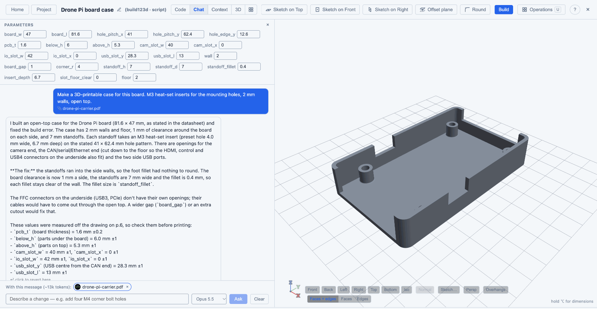

---

## The ideas behind it

### Describe the intent; the AI does the modelling

Most CAD time goes into translating an idea into a sequence of tool operations.
In IntentCAD you start from the idea: *"a case for this board, M3 heat-set inserts,
2 mm walls, open top"*. The AI builds it, and you keep talking to it to change it:
*"move the USB cutout 2 mm up"*, *"fillet these edges"*, *"make the lid snap on"*.
Select something in the 3D view first and the AI knows exactly which face or edge you
mean.

### The model is readable, exact and yours

Behind every part is a short, readable script (Python, using the build123d CAD
library) with its key dimensions collected in one place, the **parameters**. That
gives you things a chat-generated mesh never could:

- **Exact geometry.** True solids with real faces and edges, exported as STEP for
  other CAD tools or as STL for printing.
- **Parametric.** Change `wall` from 2 to 3 and everything that depends on it
  follows: sketches, holes, fillets, mirrored and patterned copies.
- **Reproducible.** The same script always builds the same part. Every successful
  build is saved as a version you can go back to.
- **Inspectable.** Nothing is hidden: you, the AI and the buttons all edit the same
  script.

### Point when pointing is easier

Some things are easier to show than to say: *this* edge, *that* face, a hole 14 mm from
*this* wall. For those, IntentCAD has button operations with live previews. Each one
writes a single, readable line into the script, with its values as parameters, and
can be reopened later to change it. The AI can edit what a button made, and a button
can reopen what the AI made.

### Built for 3D printing

IntentCAD knows parts are going to a printer: heat-set insert and screw-hole presets,
standoffs, an overhang check against the print bed, a section view to check walls and
insert depths, shells for enclosures, and automatic softening of edges that keeps
mounting and bed faces sharp.

### Honest numbers

When the AI takes dimensions from a datasheet or a photo, every number says where it
came from: stated in the document, estimated from a drawing's scale, measured from a
photo, or given by you. Estimates are never presented as exact, so you know what to
check before printing.

---

## A quick tour: a case for a circuit board

1. **Give it context.** Add the board's datasheet (a PDF with a dimension drawing) or a
   photo of the board to the project.

   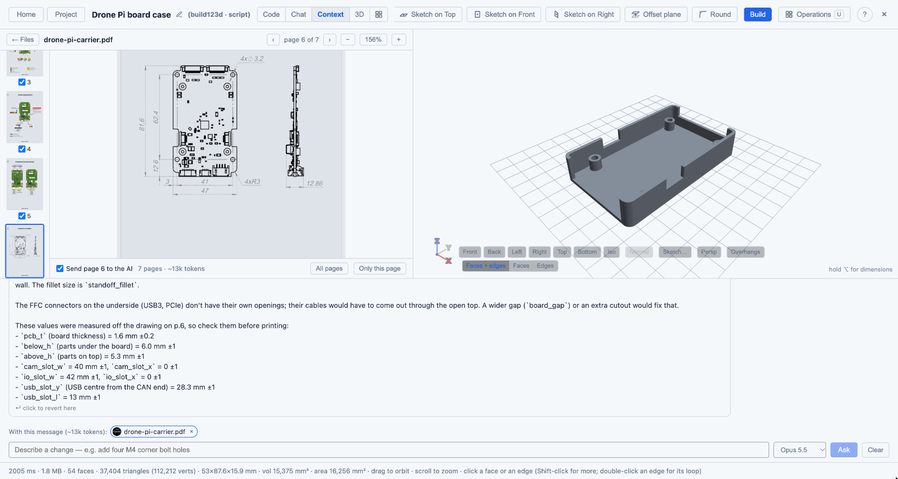

2. **Ask for the case.** *"Make a 3D-printable case for this board. M3 heat-set inserts
   for the mounting holes, 2 mm walls, open top."* The AI reads the drawing, puts the
   board size and hole pattern into the parameters with their source, and builds the
   case.

   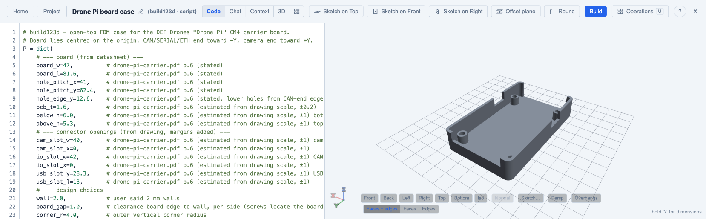

3. **Refine by pointing.** Select the side wall, sketch the USB opening on it, cut it.
   Drag a parameter's arrow on the model to change it directly.

   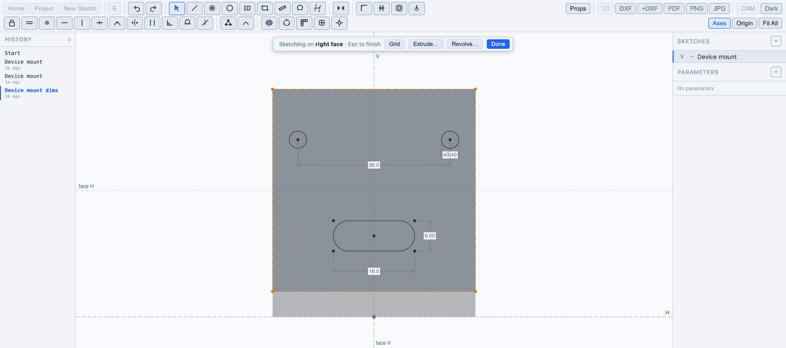

4. **Check it's printable.** Cut the part open with the section view to see wall
   thickness and insert depth; switch on the overhang check.

   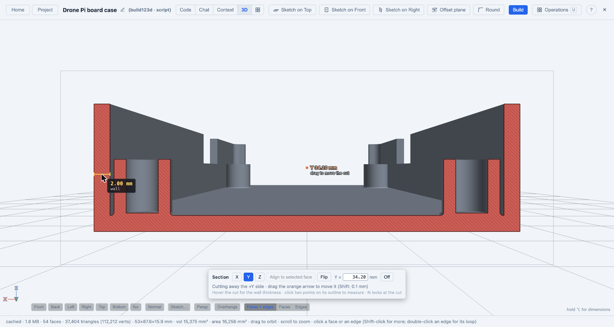

5. **Change your mind.** Make the case 10 mm taller, the walls thicker, the board
   bigger: everything follows.

---

## What you can do

### Design with AI

- Chat to create and change parts; the AI writes and edits the model script.
- Select faces and edges first to say precisely what you mean.
- The AI asks a question when something is ambiguous instead of guessing.
- **Process notes**: tell it how the part will be made (printer, material, clearances)
  and every edit respects it.
- **Fix with AI**: when a build fails (a fillet too big, say), one click asks the AI to
  repair it, keeping your intent.

### Sketch

A full 2D sketcher, usable on its own (for laser and CNC work) and directly on the
faces of a part:

- Lines, polylines with arcs, rectangles (with rounded corners), circles, polygons,
  points, Bézier curves.
- Constraints: coincident, horizontal/vertical (lines or two points), parallel,
  perpendicular, tangent, equal, midpoint, symmetric, point on curve, fixed.
- Dimensions that can be formulas using the part's parameters, e.g. `floor + 2`.
- Corner fillet, trim, offset (stays linked to its source), mirror, grid and circular
  copies.
- Built-in horizontal and vertical axes in every sketch, ready to mirror about.

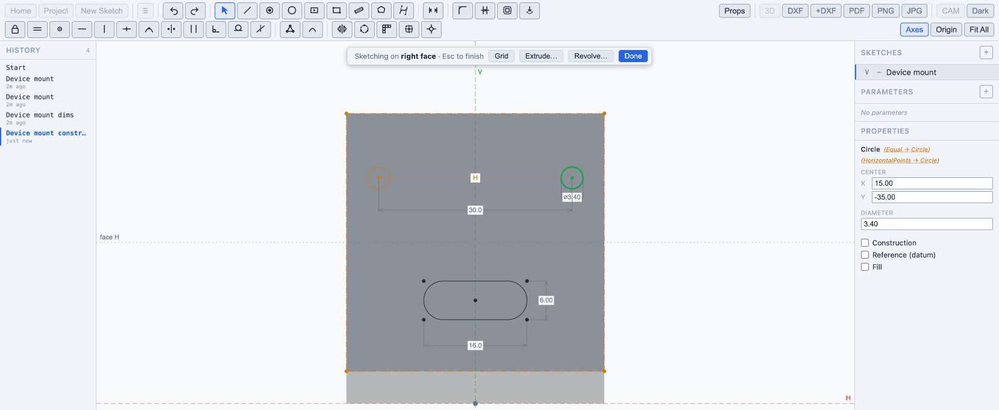

### Sketch on the part

- Select a flat face or a construction plane and press K: the full sketcher opens on it.
  With nothing selected, K offers the Top, Front and Right planes. Done or Esc takes
  you back to the part, with the sketch drawn on it.
- The face's outline comes into the sketch as reference geometry; click other edges of
  the part to bring them in too, and dimension to them.
- Sketches **follow the part**: if the face moves or its edges change, the sketch moves
  with it.

### Build the part

- **Extrude**: add, cut or start a new body; to a depth, both ways, through everything,
  up to a face, or up to the next face.
- **Revolve**: knobs, spacers, pulleys, grooves; full or partial turns.
- **Hole**: clearance, tapped, heat-set insert, counterbore and countersink, in M2 to M5,
  at sketch points; optionally on a **standoff** with a strengthening fillet at its foot.
- **Shell**: hollow a solid into walls, leaving the faces you choose open.

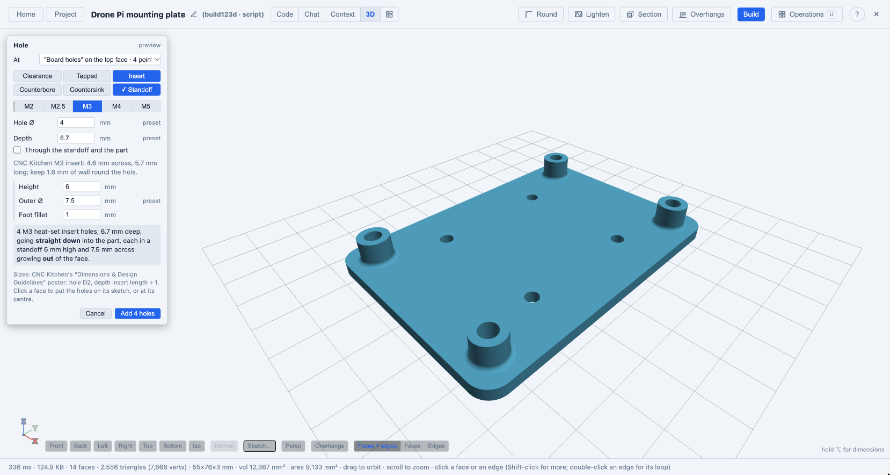

### Modify

- **Fillet** and **chamfer** the edges you pick (click, Shift-click, or double-click for
  a whole loop).
- **Round**: soften every edge of the part automatically, keeping protected faces
  (mounting faces, the print bed) exactly flat and sharp.
- **Lighten**: cut windows into a flat plate, leaving a rim and ribs around the
  mounting points.

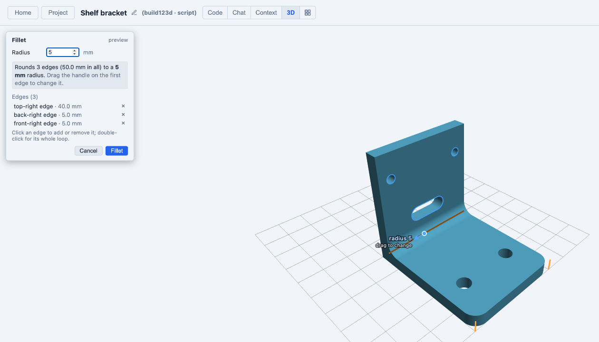

### Symmetry and repetition

- **Mirror** a whole body (model half, mirror to complete it), or mirror chosen steps
  as linked copies that follow their original.
- **Pattern** in a line, a grid or a circle (vents, ribs, bolt circles), leaving out
  any copy you click.

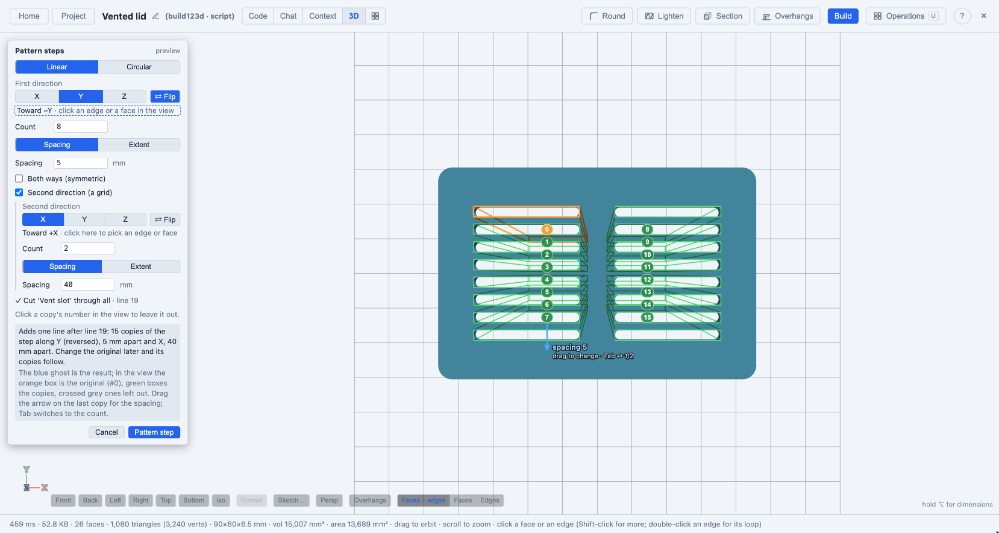

### Reference geometry

- **Construction planes**: offset from a face or base plane (a midplane is just an
  offset of half the width), on an edge at an angle, or tangent to a cylinder for
  radial holes. They follow the part like everything else.

### Parameters and direct manipulation

- All key dimensions live in one parameters list. Type a value, or **drag the arrow**
  on the model and watch the part follow.
- Hold Alt (⌥) to see every parameter drawn as a dimension on the geometry it controls.
- Every operation is a step you can **reopen**, **switch off** or **delete** from the
  steps list.

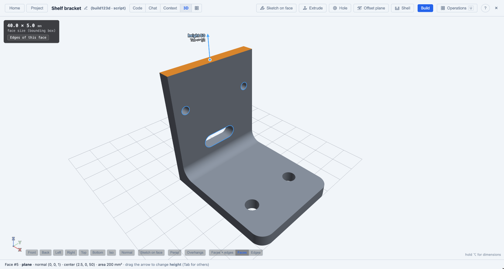

### Inspect for printing

- **Section view**: cut the part open with a draggable plane; read wall thickness and
  distances straight off the cut.
- **Overhangs**: faces that would print as overhangs or ceilings are shaded, relative to
  the print bed you choose; one click asks the AI for printable fixes.
- **Measure**: distances, diameters and angles between faces and edges.

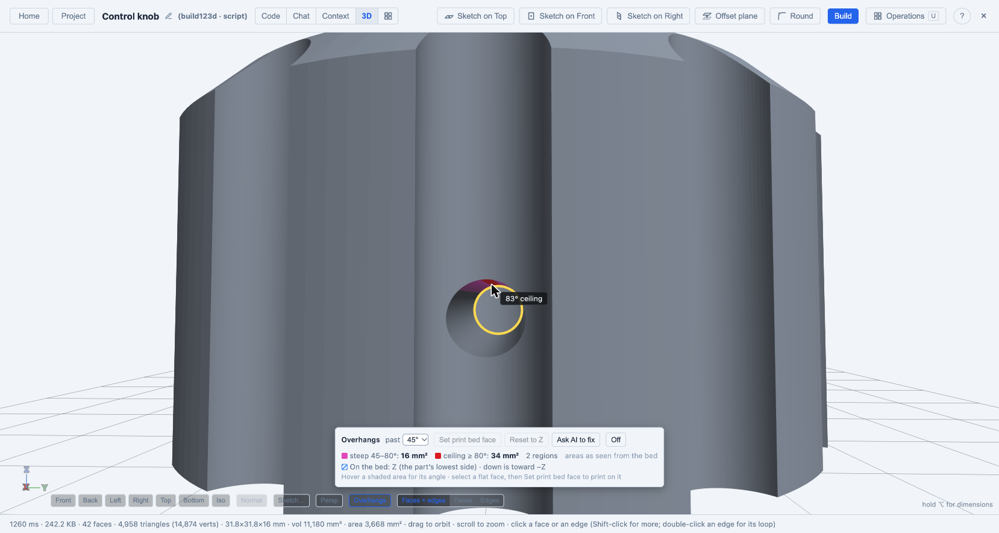

### Context files

- Attach datasheets (PDF) and photos to a part or a whole project.
- The AI reads them when designing, and cites the page or photo each dimension came
  from.

### Import and export

- Import STEP files and keep designing on top of them.
- Export STEP (for other CAD tools), STL (per body, too), and DXF outlines (top, front
  and side).

### Projects, versions and sharing

- Organise parts and sketches in projects; share projects with others.
- Every successful build is a version; restore any of them.

### Beyond 3D: 2D and CNC

The 2D editor exports DXF, PDF and images, imports DXF, and generates CNC toolpaths
(profile, pocket, drill, facing) with G-code and a simulator.

Click **CAM** in the toolbar to open the CAM panels. Add an operation, select the shapes
it cuts, and set its options:

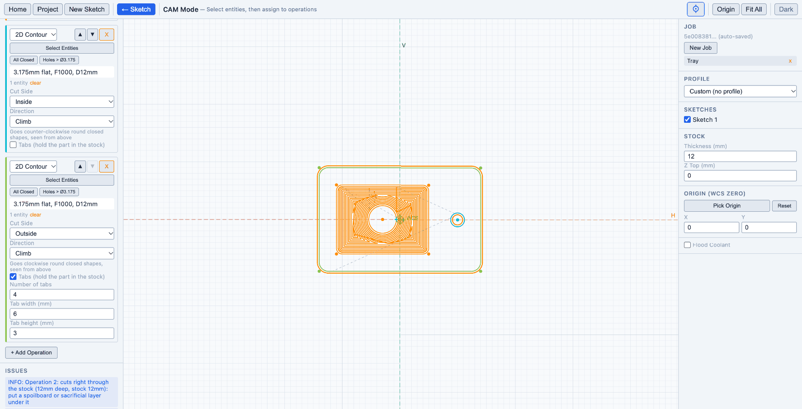

- **Profile** cuts along a shape, inside, outside or on the line. Sharp outside corners
  are cut round, and inside corners stay as sharp as the tool allows. Select a part's
  outline and its holes together: a shape inside another is a hole and is cut on its
  inside, and holes are cut before the outline. **Direction**
  chooses climb or conventional milling; the hint under it says whether the tool goes
  clockwise or counter-clockwise round the shape.
- **Tabs** keeps the part joined to the stock. Tick it and set the number of tabs, their
  width and their height. On the deepest passes the tool lifts over each tab. Tabs are
  spread round the shape and kept off its corners.
- **Pocket** clears everything inside a closed shape. Select several shapes to cut
  several pockets in one operation. A shape inside another is an island and is left
  standing. If part of a pocket is too narrow for the tool, a warning says so.

Under **Stock**, **Z Top** is the height of the top of the stock; all depths are
measured down from it. Set the machine's Z zero there. An operation as deep as the stock
gets a note to put a spoilboard under it. A cut deeper than the stock gets a warning.

---

## What IntentCAD deliberately doesn't do

To stay simple and focused on printed parts, IntentCAD leaves out assemblies with
moving joints between separate documents, 2D technical drawings, simulation, sheet
metal, surface modelling and rendering. Rarely needed shapes (sweeps, lofts, threads,
coils) have no buttons, but the AI can build them when you ask.

---

*This guide grows with IntentCAD. For what's being built next, see
[the feature plan](../feature-plan.md).*
