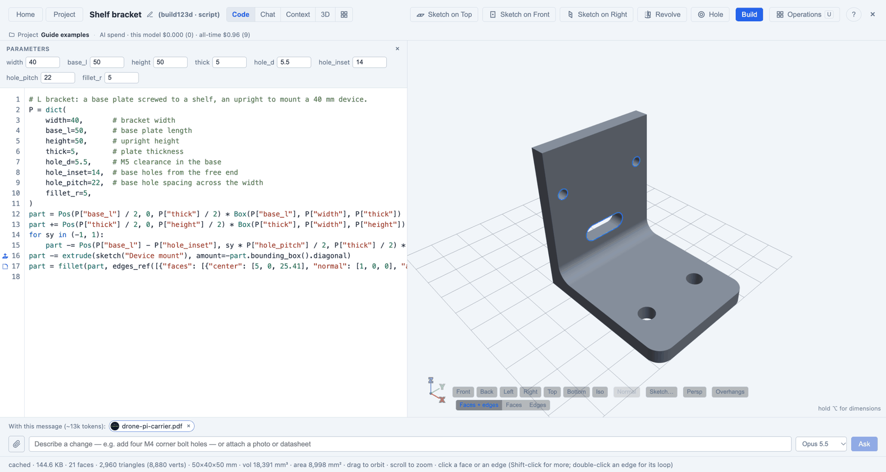
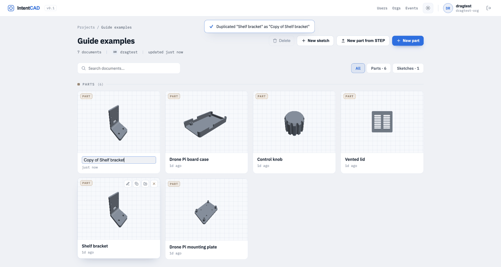
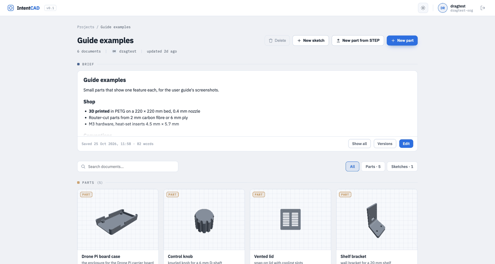
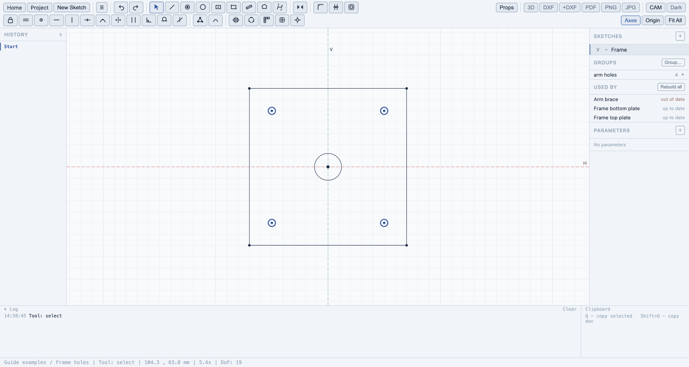
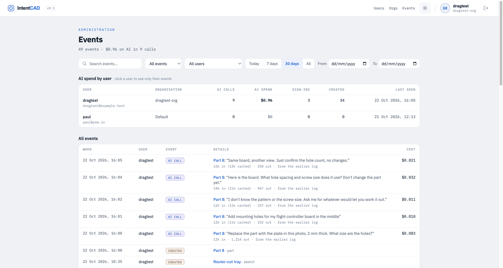
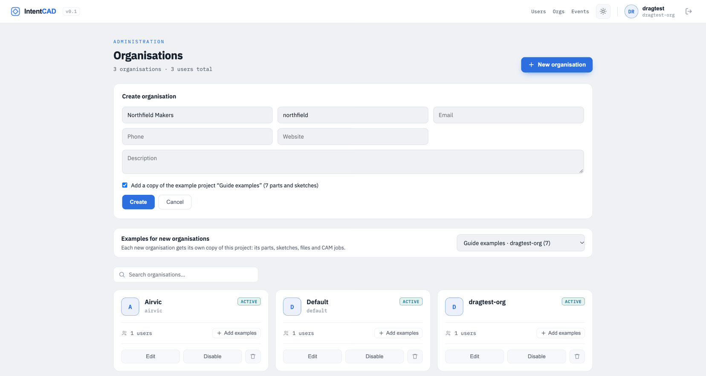

# IntentCAD

**Parametric CAD for 3D printing, driven by AI, with exact geometry you can still
point at, measure and tweak.**

IntentCAD is a web-based CAD tool for designing functional parts: enclosures,
brackets, mounts, knobs, adapters. You describe what you want, the AI builds it as an
exact, parametric model, and you refine it with the same tools you'd find in Fusion or
Onshape (sketches, extrudes, fillets, holes, patterns) whenever pointing is easier
than describing. It's open source (MIT).

---

## The ideas behind it

### Describe the intent; the AI does the modelling

Most CAD time goes into translating an idea into a sequence of tool operations.
In IntentCAD you start from the idea: *"a case for this board, M3 heat-set inserts,
2 mm walls, open top"*. The AI builds it, and you keep talking to it to change it:
*"move the USB cutout 2 mm up"*, *"fillet these edges"*, *"make the lid snap on"*.
Select something in the 3D view first and the AI knows exactly which face or edge you
mean.

### The model is readable, exact and yours

Behind every part is a short, readable script (Python, using the build123d CAD
library) with its key dimensions collected in one place, the **parameters**. That
gives you things a chat-generated mesh never could:

- **Exact geometry.** True solids with real faces and edges, exported as STEP for
  other CAD tools or as STL for printing.
- **Parametric.** Change `wall` from 2 to 3 and everything that depends on it
  follows: sketches, holes, fillets, mirrored and patterned copies.
- **Reproducible.** The same script always builds the same part. Every successful
  build is saved as a version you can go back to.
- **Inspectable.** Nothing is hidden: you, the AI and the buttons all edit the same
  script.

### Point when pointing is easier

Some things are easier to show than to say: *this* edge, *that* face, a hole 14 mm from
*this* wall. For those, IntentCAD has button operations with live previews. Each one
writes a single, readable line into the script, with its values as parameters, and
can be reopened later to change it. The AI can edit what a button made, and a button
can reopen what the AI made.

### Built for 3D printing

IntentCAD knows parts are going to a printer: heat-set insert and screw-hole presets,
standoffs, an overhang check against the print bed, a section view to check walls and
insert depths, shells for enclosures, and automatic softening of edges that keeps
mounting and bed faces sharp.

### Honest numbers

When the AI takes dimensions from a datasheet or a photo, every number says where it
came from: stated in the document, estimated from a drawing's scale, measured from a
photo, or given by you. Estimates are never presented as exact, so you know what to
check before printing.

---

## A quick tour: a case for a circuit board

1. **Give it context.** Add the board's datasheet (a PDF with a dimension drawing) or a
   photo of the board to the project.

   

2. **Ask for the case.** *"Make a 3D-printable case for this board. M3 heat-set inserts
   for the mounting holes, 2 mm walls, open top."* The AI reads the drawing, puts the
   board size and hole pattern into the parameters with their source, and builds the
   case.

   

3. **Refine by pointing.** Select the side wall, sketch the USB opening on it, cut it.
   Drag a parameter's arrow on the model to change it directly.

   

4. **Check it's printable.** Cut the part open with the section view to see wall
   thickness and insert depth; switch on the overhang check.

   

5. **Change your mind.** Make the case 10 mm taller, the walls thicker, the board
   bigger: everything follows.

---

## What you can do

### Design with AI

- Chat to create and change parts; the AI writes and edits the model script.
- Select faces and edges first to say precisely what you mean.
- The AI asks a question when something is ambiguous instead of guessing.
- Ask it a question ("how thick is the wall?") and it answers in the chat without
  changing the model.
- **Process notes**: tell it how the part will be made (printer, material, clearances)
  and every edit respects it.
- **Fix with AI**: when a build fails (a fillet too big, say), one click asks the AI to
  repair it, keeping your intent.

### Sketch

A full 2D sketcher, usable on its own (for laser and CNC work) and directly on the
faces of a part:

- Lines, polylines with arcs, rectangles (with rounded corners), circles, polygons,
  points, Bézier curves.
- Constraints: coincident, horizontal/vertical (lines or two points), parallel,
  perpendicular, tangent, equal, midpoint, symmetric, point on curve, fixed.
- Dimensions that can be formulas using the part's parameters, e.g. `floor + 2`.
- Corner fillet, trim, offset (stays linked to its source), mirror, grid and circular
  copies.
- Built-in horizontal and vertical axes in every sketch, ready to mirror about.

### Sketch on the part

- Select a flat face or a construction plane and press K: the full sketcher opens on it.
  With nothing selected, K offers the Top, Front and Right planes. Done or Esc takes
  you back to the part, with the sketch drawn on it.
- The face's outline comes into the sketch as reference geometry; click other edges of
  the part to bring them in too, and dimension to them.
- Sketches **follow the part**: if the face moves or its edges change, the sketch moves
  with it.

### Build the part

- **Extrude**: add, cut or start a new body; to a depth, both ways, through everything,
  up to a face, or up to the next face.
- **Revolve**: knobs, spacers, pulleys, grooves; full or partial turns.
- **Hole**: clearance, tapped, heat-set insert, counterbore and countersink, in M2 to M5,
  at sketch points; optionally on a **standoff** with a strengthening fillet at its foot.
- **Shell**: hollow a solid into walls, leaving the faces you choose open.

### Modify

- **Fillet** and **chamfer** the edges you pick (click, Shift-click, or double-click for
  a whole loop).
- **Round**: soften every edge of the part automatically, keeping protected faces
  (mounting faces, the print bed) exactly flat and sharp.
- **Lighten**: cut windows into a flat plate, leaving a rim and ribs around the
  mounting points.

### Symmetry and repetition

- **Mirror** a whole body (model half, mirror to complete it), or mirror chosen steps
  as linked copies that follow their original.
- **Pattern** in a line, a grid or a circle (vents, ribs, bolt circles), leaving out
  any copy you click.

### Reference geometry

- **Construction planes**: offset from a face or base plane (a midplane is just an
  offset of half the width), on an edge at an angle, or tangent to a cylinder for
  radial holes. They follow the part like everything else.

### Parameters and direct manipulation

- All key dimensions live in one parameters list. Type a value, or **drag the arrow**
  on the model and watch the part follow.
- Hold Alt (⌥) to see every parameter drawn as a dimension on the geometry it controls.
- Every operation is a step you can **reopen**, **switch off** or **delete** from the
  steps list.

### Inspect for printing

- **Section view**: cut the part open with a draggable plane; read wall thickness and
  distances straight off the cut.
- **Overhangs**: faces that would print as overhangs or ceilings are shaded, relative to
  the print bed you choose; one click asks the AI for printable fixes.
- **Measure**: distances, diameters and angles between faces and edges.

### Context files

- Attach datasheets (PDF) and photos to a part or a whole project.
- The AI reads them when designing, and cites the page or photo each dimension came
  from.
- To add one while you chat, click the paperclip left of the message box, or drop or
  paste a file into the chat. On a phone, the paperclip offers the camera.
- The files go with your next message; they show as chips above the box, and the sent
  message lists them after 📎. Click × on a chip to leave a file out.
- If you send while a file is still uploading, the message waits for it.
- When the AI asks you a question, an **Attach a file** button shows under it: answer
  with a photo, a drawing or a datasheet if that's easier than typing. Pick the file,
  add a sentence and send.
- The **Context** tab lists all the files, and lets you choose which PDF pages the AI
  sees.

### Import and export

- Import STEP files and keep designing on top of them.
- Export STEP (for other CAD tools), STL (per body, too), and DXF outlines (top, front
  and side).

### Projects, versions and sharing

- Organise parts and sketches in projects; share projects with others.
- In the part editor, the line under the top bar names the project the part is in.
  Click the name to go back to the project.
- Keep your place: Cmd-click (Ctrl-click on Windows) or middle-click the IntentCAD logo,
  Home, Project, a project or a part card to open it in a new tab.
- Every successful build is a version; restore any of them.
- **Duplicate** makes a copy of a part or sketch in the same project. Hover over its
  card in the project and click the two-squares button (between Rename and Move). The
  copy is called "Copy of <name>", its name is ready to edit, and Enter keeps it. It
  has the model as it is now (script, sketches, parameters, print bed face, chat),
  the STEP files it imports, the part's own context files and its CAM jobs (generate
  the G-code again). Its version history starts fresh.

### The project as context for the AI

The AI in a part's chat knows the project the part is in, not only the part.

- **Brief**: a short Markdown note at the top of the project page: what the project is,
  its materials, hardware and rules (say "2 mm carbon fibre, M3 throughout, 4 mm from
  any edge"). Every part's AI reads it first. Click **Edit** (or **Write a brief**),
  write in the Write tab, check it in Preview, and **Save** (⌘S). Each save is kept:
  **Versions** lists them, and **Restore…** opens an older one to save again. Keep it
  under about 2,000 words; past that the count turns red, because every message in
  every part carries it.
- **Descriptions**: one line per part or sketch on what it's for ("the arms bolt to
  it"). Hover over a card in the project and click the lines button, or click the line
  under the top bar in the part editor. The AI sees it in the list of the project's
  parts.
- **The other parts**: the AI sees a list of the project's other parts and sketches
  (name, description, size from the last build, key parameters) and can open one to
  read its script or parameters when your question needs it. Ask "what does the
  bottom plate's hole pattern look like?" in the top plate's chat and it looks. It
  only ever changes the part you're in.
- **@-mentions**: type @ in the chat box and pick a part or sketch (arrow keys and
  Enter, or click) to send its summary with your message.
- **Brief changes**: when you settle something the whole project should remember (a
  bolt size, a bought part), the AI may propose a change to the brief. It shows as a
  diff under its reply; **Accept** saves it as a new brief version, **Reject** drops
  it. The AI never changes the brief itself.

### Shared sketches and parameters

Parts that must agree (a top plate, a bottom plate and a brace bolting to the same
arm holes) can build from one sketch and one set of sizes in the project, so a change
in one place reaches every part.

- **Shared sketch**: draw it in a sketch document in the project. Draw it in the
  project frame (say origin at the frame centre, Z up) and note that in the brief.
- **Groups and names**: in the sketch editor, select elements and click **Group…**
  in the Groups panel on the right to name them ("arm holes"). Click a group to select
  its elements; double-click to rename it. A part's script reads a group as
  `SK["frame"].group("arm holes")`, a named element as `.named("outline")`, and every
  hole as `.circles` (centre and radius).
- **Use it in a part**: in the part editor, open **Use project sketch** (File group of
  the operations, or the AI). Choose the sketch document, name it for the script
  ("frame"), and click **Use it**. The script then reads it as `SK["frame"]`. The
  dialog lists the sketches the part uses; × stops using one.
- **Parameters**: the **Parameters** table on the project page, under the brief, holds
  sizes every part shares (plate thickness, tube diameter). Click a cell to edit it;
  the row saves when you leave it. **Add parameter** adds one; × deletes it. Scripts
  read them as `PP["plate_t"]`.
- **Out of date**: change the sketch (its shapes, its groups or names) or a parameter,
  and the parts built from it show **OUT OF DATE** on their cards. In the sketch editor,
  **Used by** lists them; **Rebuild all** rebuilds them with the sketch as it is now.
  Opening a part rebuilds it too.
- **Renames that break parts**: if a save would remove a group or named element a part
  uses, the sketch editor holds the save and lists the parts it would break. Click
  **Save anyway** or undo the change.
- **Versions**: a part version keeps the sketch and parameter values it was built with.
  Restoring it builds the old shape, and its card says **PINNED**. A note under the
  script says what has changed since; **Follow latest** builds with today's sketch and
  parameters again.
- **The AI**: ask it to "switch the brace to the frame's arm holes" and it replaces
  copied numbers with `SK[...]`, adding the sketch to the part if needed. It may
  propose a new or changed project parameter; it shows under its reply with the old
  value struck through, and nothing changes until you click **Accept**.

### Beyond 3D: 2D and CNC

The 2D editor exports DXF, PDF and images, imports DXF, and turns sketches into G-code
for a CNC router.

Click **CAM** in a sketch's toolbar. CAM has three steps along the top: **Setup**,
**Plan** and **Run**. **Job** picks a job or adds one; jobs save by themselves. **Exit
CAM** (or Esc) goes back to drawing. **Fit** (Shift+F) frames the stock.

**1 Setup** says what you cut on, once per job:

- **Machine**: the router. **Edit machine** sets its controller, travel, top speed, how
  the spindle speed is set (by the program, or by hand on a dial with a table of
  settings), rapid speed, tool changes (a pause, M6 or an automatic changer), safe and
  clearance heights, where it parks, coolant, and the **spoilboard allowance**: how far
  a through cut goes past the stock (0.3 mm unless you change it). **Default material**
  is the material new jobs start with (birch ply until you change it): set it once and
  click **Save**. A new job starts on the machine you saved last, so it takes that
  material too. Jobs you already have keep theirs.
- **Tool library**: the machine's bits. **Manage tools** adds and edits them. Each bit
  has cutting data per material: chip load, depth per pass, stepover, plunge speed and
  ramp angle. Birch ply, MDF, hardwood, acrylic, aluminium 6061 and carbon fibre come
  filled in, and you can change them. The feed is always worked out (chip load × flutes
  × rpm), never typed.
- **Stock**: width, height, thickness and material. Leave width and height empty to fit
  the shapes plus 10 mm a side.
- **Carbon fibre**: pick *Carbon fibre (CFRP)* as the material. Its cutting data uses a
  small chip, shallow passes (a quarter of the bit: 0.8 mm for a 3 mm bit, 1.5 mm for a
  6 mm one) and a ramp in, to keep the edges from splintering. Setup shows a reminder:
  the dust is harmful and conducts electricity, so run the dust extraction or cut wet
  and wear a mask, and use carbide or diamond-coated bits. Run's steps at the machine
  start with the same reminder. To start every new job in carbon fibre, set it as the
  machine's **Default material**.
- **Origin**: where X0 Y0 is: a corner, an edge's middle or the centre of the stock, or
  **Pick a point on the sketch** (it snaps to shape ends and centres). **Z0 at** is the
  stock top or the spoilboard.
- **Clamps**: click **Draw on the sketch**, drag a box where the clamp is, and set how
  tall it stands. A rapid move that would pass a clamp rises to the clearance height to
  cross it. A cut into a clamp is an error.
- **Fill in with AI** fills these in from the drawing. Whatever the AI set has a violet
  dot. Its changes wait for you: **Confirm** keeps them, **Undo** puts back what was
  there. Nothing downloads until you've chosen.

**2 Plan** lists the operations, in the order they run, with the number of tool changes
and the time:

- **Plan with AI** proposes the operations, each with its reason. Proposed ones have a
  violet **Proposed** label: click **Accept**, or **Accept all**.
- **+ Add an operation** adds one yourself. Click shapes on the sketch to add them to the
  selected operation or take them out; double-click picks a whole outline.
- Lines that meet end to end are one outline. Double-click any of them to pick them all;
  the card then says, for example, "1 outline (12 lines)". A line that doesn't close an
  outline is an error, unless you cut on the line.
- Selecting an operation shows its shapes in blue and its toolpath in orange, with tabs
  marked. The stock, the clamps (hatched red) and X0 Y0 show on the sketch.
- The defaults come from the setup: an outside profile cuts right through (the stock
  thickness plus the allowance) with tabs, holes use a drill bit (or a helix with an end
  mill), pockets use the largest bit that fits, bits long enough for the depth and bits
  already in use come first. A drill bit also goes its point's length further, so the
  hole is full size at the bottom.
  **Order** puts inside cuts first, then groups by tool, with the cut that frees the part
  last.
- A problem shows on its operation; **Fix with AI** asks the AI to fix it. It can change
  the settings or the shapes the operation cuts; **Reject** puts them back.
- An outside profile shallower than the stock won't free the part, so it warns; **Reset**
  the depth in **Open** to cut right through.
- The box at the bottom talks to the AI: "add a chamfer pass", "use the 6 mm bit for the
  pockets", "why two passes?". Its changes come back as proposed. If it changes an
  operation you had accepted, **Reject** puts it back as it was. It can remove only its
  own proposals; it asks you to remove the rest. It names shapes by their size and
  place ("the Ø4 circle at (10, 10)") and operations by their number.

**Open** an operation to change it. Its settings are grouped as What, Tool, Depth,
Speeds and feeds, and How it cuts. A dot beside each value says where it comes from:
grey is inherited from the setup and tool, amber is set here (with what it was, and
**Reset**), violet was set by the AI. A diagram shows the passes. **Ask AI about this
operation** asks about just this one; **Done** goes back to the plan.

- **Profile** cuts along a shape, inside, outside or on the line. A shape inside
  another is a hole and is cut on its inside, before the outline. **Direction** picks
  climb or conventional.
- **Tabs** keep the part joined to the stock; set their number, width and height.
- **Pocket** clears inside a closed shape and leaves islands standing.
- **Drill** drills holes, pecking if you set a peck depth.

**3 Run** checks the job before you cut: errors (such as a proposed operation not yet
accepted, AI setup changes not confirmed, a cut into a clamp, deeper than the bit
reaches, or further below the stock than the spoilboard allowance) block the download
and hide the G-code, and warnings say what to check.
**Play** runs the simulator; the line running is highlighted in the G-code. **At the
machine** lists what to do there: the bit to fit, where to zero, and each tool change
and dial setting. **Download .nc** saves the G-code.

The AI never changes the machine's settings, its post-processor or its safe heights.
What it changes in the job waits for you to accept or confirm it, and goes through the
same checks as your own operations.

### Events and AI spend (superusers)

The Events page shows what users have done: signing in and out (and failed sign-ins),
making a part or sketch, and each AI call with what it cost. Use it to see who spends
how much on the AI.

Click **Events** in the top bar (only superusers see it). The line under the title adds
up the events and the AI spend for the filters you've set.

- **AI spend by user** lists each user's AI calls, spend, sign-ins, parts and sketches
  made, and when they were last seen. Click a user to see only their events; click
  again to see everyone.
- The events list is newest first. An AI call shows its part or sketch (click to open
  it), what was asked, the model, the tokens and the cost. A sign-in shows the address
  and browser. **Load more** shows older events.
- Filter with the search box (a user, a part or sketch name, or words from an AI
  request), the event kind, the user, and the period: **Today**, **7 days**,
  **30 days** (the default), **All**, or your own **From** and **To** dates. The page
  keeps the filters in its address, so you can bookmark or share a view.

Events from before the page existed were copied in from the earlier sign-in and AI
logs; those have no sign-outs.

### Example parts for new organisations (superusers)

New organisations can start with a set of example parts and sketches to look at and
try things on. You choose one project as the examples; each new organisation gets its
own copy of it, called by the same name. The copy has every part and sketch (the model,
its STEP files, its context files, its CAM jobs; generate the G-code again) and the
project's context files. Changing the copy doesn't change the original.

Click **Orgs** in the top bar (only superusers see it).

- Under **Examples for new organisations**, pick the project to copy, or **None** to
  stop adding examples.
- **New organisation** has a box, ticked, to add a copy of the example project. Untick
  it to make an empty organisation. A note at the top says what was added.
- **Add examples** on an organisation's card adds a copy to an organisation made
  earlier. It is refused if the organisation already has a project of that name.

---

## What IntentCAD deliberately doesn't do

To stay simple and focused on printed parts, IntentCAD leaves out assemblies with
moving joints between separate documents, 2D technical drawings, simulation, sheet
metal, surface modelling and rendering. Rarely needed shapes (sweeps, lofts, threads,
coils) have no buttons, but the AI can build them when you ask.

---

*This guide grows with IntentCAD. For what's being built next, see
[the feature plan](../feature-plan.md).*
